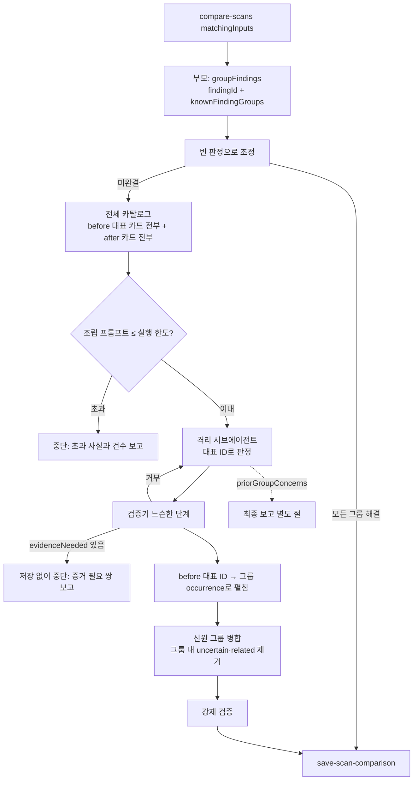
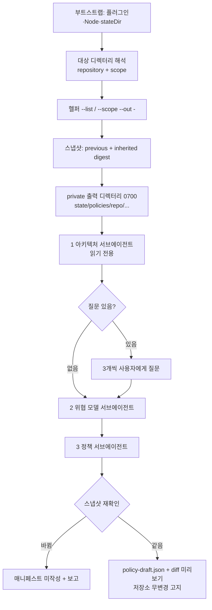
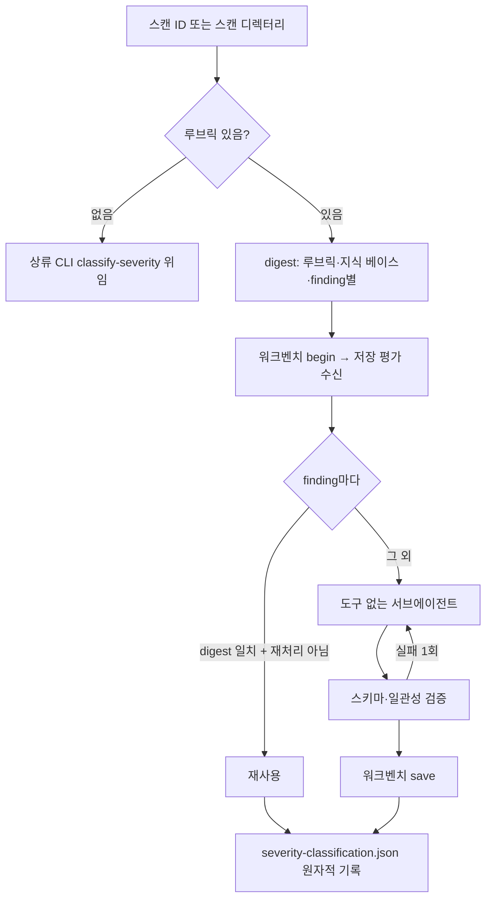

# codex-security 0.1.29 기준 정합과 신규 CLI 기능 스킬화 - Plan

## Goal Capsule

- **Objective**: Claude Code 구독만 있는 사용자가 codex-security npm 0.1.29 환경에서 이 스킬들로 스캔·매칭·수정·검증을 중단 없이 수행하고, 0.1.29 CLI가 새로 제공하는 SECURITY.md 초안 작성과 심각도 재분류도 OpenAI 인증 없이 쓸 수 있다.
- **Means**: 기준 플러그인을 npm 0.1.25(매니페스트 0.1.94)에서 npm 0.1.29(매니페스트 0.1.95)로 올리고, 깨지는 지점과 계약 변화를 반영하고, 모델 호출이 필요한 신규 CLI 기능 두 개를 스킬로 추가한 뒤 `v0.1.29`로 배포한다 (P6-KTD1, P6-KTD2).
- **권위 순서**: 실측 > 상류 번들 파일 > 상류 소스·git 이력 > 우리 문서. 상류 문구와 우리 서술이 충돌하면 상류가 이긴다. 단 승인 게이트, 격리 경계, 정직성 보고, 저장소 불변, 터미널 정본 경로(셸로 쓴 draft → `finalize_scan_contract.py` → 선택적 워크벤치 `complete-scan`)는 우리 고유 계약이며 상류에 없어도 유지한다.
- **정지 조건**: U1 재실측에서 계획 전제와 다른 관측이 나오면 멈추고 기록한다. 자기채점 회귀 스크립트가 exit 0이 아니면(exit 2 `INCOMPLETE` 포함) 배포로 넘어가지 않는다. 상류 영문 원문을 리터럴로 고정하는 곳은 복사 시점 커밋을 기록하지 않으면 완료로 보지 않는다.
- **범위 밖**: 상류 저장소 수정, MCP 저장 도구 도입, Deep 스캔 재개·재실행, GitLab MR 생성, 매칭 페이지·증거 요청 루프.
- **완료 주체**: `ce-work`가 U1~U11을 순서대로 수행한다. 배포(U11의 태그·업로드)는 외부 게시이므로 실행 직전에 사용자 확인을 받는다.

---

## Product Contract

### Summary

스킬 7종의 기준을 npm 0.1.29(매니페스트 0.1.95)로 올린다. 0.1.29에서 동작이 깨지는 세 지점(SECURITY.md 헬퍼 삭제, 매칭 계약 재설계, MCP 전용 저장 정책)을 먼저 고친다. 그다음 인벤토리·리포트·finalizer 변화를 반영하고, 신규 스킬 `codex-security-policy`와 `codex-security-classify-severity`를 추가하고, 수정 스킬에 사용자 검증 지시 입력을 더한다. 마지막에 스킬 9종으로 `v0.1.29`를 배포한다.

### Problem Frame

이 저장소의 스킬은 상류 플러그인을 벤더링하지 않고 런타임에 읽어 쓴다. 상류는 npm 0.1.25 이후 4개 릴리즈(0.1.26~0.1.29) 동안 매니페스트를 0.1.95로 한 번 올렸고, 그 사이에 우리 스킬이 기대던 계약 셋을 바꿨다.

첫째, **실행이 깨진다.** 전체 스캔 스킬이 호출하는 `scripts/resolve_security_md.py`가 삭제되고 Node 헬퍼(`launch_codex_security_mcp --helper resolve-security-md`)로 옮겨졌다. 대상 저장소에 `SECURITY.md`가 있으면 스캔 0단계가 파일 없음으로 실패한다.

둘째, **매칭 판정이 상류와 갈린다.** 상류 `scan-comparison.ts`는 기확정 그룹을 모델 제약으로 넘기던 방식을 버렸다. 이제 호스트가 같은 `findingId`와 기확정 그룹을 먼저 카드 한 장으로 접는다. 신원만으로 끝나지 않으면 모델이 전체 카탈로그(before 대표 카드 전부 + after 카드 전부)를 판정하고, 호스트가 결과를 다시 펼쳐 신원 그룹과 합친 뒤 강제 검증한다. 우리 스킬에 고정한 영문 판정 문장 중 한 줄은 상류에서 삭제되었고 `related`의 정의도 바뀌었다.

셋째, **상류 문서가 우리 경로를 금지한다.** 상류 스킬 문서 대부분이 새 `references/artifact-storage.md`를 먼저 읽으라고 지시한다. 이 정책은 MCP 저장 도구를 전제하고 "셸로 작성한 정본 파일로 대체하지 말라"고 쓴다. 런타임에 이 문서를 읽는 에이전트는 우리 터미널 경로를 금지로 읽고 스캔을 멈출 수 있다.

여기에 **기능 공백**이 더해진다. 0.1.29 CLI에 SECURITY.md 초안 작성(`policy`)과 루브릭 기반 심각도 재분류(`classify-severity --rubric`)가 생겼다. 둘 다 OpenAI 모델을 호출하므로 구독 사용자는 쓸 수 없다. 반면 `scan import`, `init`, 루브릭 없는 `classify-severity`, `policy --dry-run`은 인증 없이 CLI로 바로 실행된다.

### Key Decisions

- **0.1.29 CLI의 모델 호출 기능을 스킬로 추가한다** (session-settled: user-directed — 신규 CLI 기능을 이번 범위에서 빼는 안 대신 선택: 버전 정합과 함께 기능 공백을 메운다). Governs R15~R24.
- **Deep 스캔 재개·재실행과 GitLab MR 생성은 제외한다** (session-settled: user-approved — 포함하는 안 대신 선택: 재개·재실행은 상류 MCP 코디네이터에 묶여 deep-lite에 대응 구조가 없고, MR 생성은 외부 게시 동작이다). Scope Boundaries의 연기 항목을 통치한다.
- **이번 작업의 종착점은 `v0.1.29` 배포다** (session-settled: user-directed — 스킬·문서 수정에서 멈추는 안 대신 선택: "버전 맞춰서 릴리즈"). Governs R28, R29.

### Requirements

**깨지는 지점**

- R1. 전체 스캔 0단계의 SECURITY.md 정책 해결은 상류 Node 헬퍼를 쓴다. 삭제된 Python 리졸버를 호출하지 않는다.
- R2. 헬퍼를 실행할 수 없거나 실행이 실패하면(0이 아닌 종료코드, 크기 한도 오류) 정책 해결을 건너뛰고, 그 사실과 사유를 최종 보고에 남긴다. 스캔은 계속한다.
- R3. 헬퍼를 실행하는 Node는 플러그인과 같은 신뢰 게이트를 통과해야 한다. 대상 저장소 안의 Node는 채택하지 않는다.
- R4. 읽는 상류 문서가 `references/artifact-storage.md`를 지시하는 스킬은, 그 MCP 저장 정책보다 자기 절차가 우선함을 명시한다. 상류 문서를 읽은 에이전트가 이 정책 때문에 멈추지 않는다.

**인벤토리·리포트·finalizer**

- R5. 스캔 문서가 0.1.29 인벤토리 규칙을 서술한다. diff 인벤토리와 랭킹 입력의 새 확장자(`.cjs` `.cts` `.mts` `.tf`), diff 인벤토리의 `.github/workflows/*` 포함, 전체 인벤토리에서 줄바꿈이 든 경로의 하드 실패가 대상이다.
- R6. 줄바꿈 경로로 인벤토리가 실패하면 사용자가 원인을 알 수 있는 안내를 받는다.
- R7. 리포트에서 `Runtime or test status` 행이 사라진 사실을 문서가 반영한다. 스킬은 `scan.scope`에 실행·테스트 상태를 계속 기록하되 리포트에 나온다고 주장하지 않는다.
- R8. finalizer의 새 동작(unsealed 매니페스트의 `artifacts: []` 허용, `deep_repository`의 `inventoryStrategy`를 `repository`로 정규화)이 우리 draft 규약과 모순되지 않는다.

**스캔 매칭**

- R9. 매칭은 상류와 같은 순서로 동작한다. 호스트 측 신원 병합 → (완결되지 않으면) 전체 카탈로그에 대한 서브에이전트 판정 → 펼침·신원 그룹과 병합 → 강제 검증.
- R10. 신원 병합만으로 모든 그룹이 끝나면 서브에이전트를 호출하지 않는다.
- R11. 서브에이전트 프롬프트는 0.1.29 `comparisonPrompt()` 판정 문장을 영문 원문 그대로 싣는다. 페이지·증거 요청 문장은 싣지 않는다.
- R12. 서브에이전트는 기확정 그룹이 틀렸다고 판단하면 그 우려를 보고할 수 있다. 우려는 저장을 막지 않고 최종 보고에 나온다.
- R13. 조립한 프롬프트가 실행 한도(P6-KTD5)를 넘거나, 서브에이전트가 카드만으로 판정할 수 없어 증거가 필요하다고 답하면, 분할·재시도하지 않고 저장 없이 중단하며, 사유와 대상 건수를 보고한다.
- R14. 로컬 검증기는 상류 `validateComparison`의 느슨한 단계와 강제 단계를 모두 재현한다.

**수정 스킬**

- R15. 수정 스킬은 사용자가 준 검증 지시(파일 또는 텍스트)를 입력으로 받는다.
- R16. 검증 지시 안의 명령은 저장소 정의 스크립트와 같은 2단 승인 대상이다.
- R17. 필수 검사가 실패하거나 실행되지 않으면 `fixed`를 보고하지 않는다.

**SECURITY.md 초안 스킬**

- R18. 새 스킬은 선택한 컴포넌트에 대해 상류와 같은 3단계(아키텍처 → 위협 모델 → 정책)로 SECURITY.md 초안을 만든다.
- R19. 초안과 중간 산출물은 저장소 밖 private 디렉터리에 저장한다. 대상 저장소의 어떤 파일도 바꾸지 않는다.
- R20. 아키텍처 단계가 낸 소유자 질문은 한 번에 최대 3개씩 사용자에게 묻는다. 답이 없으면 미해결로 남긴다.
- R21. 생성 중에 대상 또는 조상 SECURITY.md가 바뀌면 매니페스트를 쓰지 않고 그 사실을 보고한다.

**심각도 재분류 스킬**

- R22. 새 스킬은 완료된 스캔의 finding을 루브릭으로 재분류하고, 결과를 상류 워크벤치 체크포인트와 스캔 디렉터리의 `severity-classification.json`에 상류 형식 그대로 저장한다. 상류 `publish`가 이 결과를 읽을 수 있어야 한다.
- R23. 루브릭이 없으면 상류 CLI의 결정론 경로에 위임한다.
- R24. 입력 digest가 같은 저장 평가는 재사용하고, 재처리를 요청하면 다시 분류한다.

**안내**

- R25. 인증 없이 CLI로 바로 실행되는 기능(`scan import`, `init`, 루브릭 없는 `classify-severity`, `policy --dry-run`)을 매뉴얼에 안내한다. 실측으로 확인한 것만 적는다.

**기준 갱신과 배포**

- R26. 스킬과 문서의 기준 버전 표기를 npm 0.1.29(매니페스트 0.1.95)로 갱신한다. 시점 고정 기록인 과거 실측 문서는 건드리지 않는다.
- R27. 신규 스킬 2종을 모든 등록 위치에 반영한다.
- R28. 회귀 스크립트가 이번에 확인한 계약을 단언으로 붙잡는다.
- R29. `v0.1.29` 태그로 배포하고, 릴리즈 노트가 변경이 실제로 도입된 상류 구간과 신규 스킬을 정확히 서술한다.

### Acceptance Examples

- AE1. Covers R1, R2. 대상 저장소에 `SECURITY.md`가 있고 npm 0.1.29 번들이 설치되어 있으면 정책이 `artifacts/01_context/security_guidance.md`에 저장된다. 상류 소스 체크아웃(`mcp/` 없음)을 쓰면 정책 해결을 건너뛰고, 최종 보고에 "정책 헬퍼 없음 — SECURITY.md 미반영"이 나온다.
- AE2. Covers R9, R10. before 스캔과 after 스캔의 모든 finding이 같은 `findingId`를 공유하면 서브에이전트 호출 없이 매칭이 저장된다.
- AE3. Covers R12. 서브에이전트가 기확정 그룹에 우려를 반환해도 저장은 진행되고, 최종 보고에 그룹 ID와 우려 근거가 별도 절로 나온다.
- AE4. Covers R19, R21. 초안 생성 중 사용자가 대상 SECURITY.md를 고치면 세 문서는 남지만 `policy-draft.json`은 생기지 않고, "생성 후 SECURITY.md가 바뀜 — 새 초안 필요"가 보고된다.
- AE5. Covers R22, R24. 같은 루브릭으로 두 번 실행하면 두 번째 실행은 서브에이전트를 호출하지 않는다. 재처리를 요청하면 모든 finding을 다시 분류한다.

### Success Criteria

- npm 0.1.29 환경에서 전체 스캔을 시작할 때 플러그인 버전 경고가 뜨지 않고, `SECURITY.md`가 있는 저장소에서도 0단계를 통과한다.
- 같은 매칭 입력에 대해 우리 스킬이 저장하는 확정 그룹이 상류 호스트 조정 규칙과 같은 모양이다(자동 병합분 포함).
- 신규 스킬로 만든 심각도 결과를 상류 TS 읽기 경로(`publish`가 쓰는 `readScanSeverityClassification`)가 digest 재확인을 거쳐 `incomplete` 오류 없이 읽는다. Python `read-severity-classification`은 digest를 거르지 않으므로 이 기준의 근거가 되지 못한다.
- 스킬 문서를 읽은 에이전트가 상류 `artifact-storage.md` 때문에 스캔을 멈추지 않는다.

### Scope Boundaries

- 상류 codex-security 저장소는 수정하지 않는다.
- MCP 앱 도구(`save_codex_security_artifact` 등)를 쓰지 않는다. 우리 경로는 셸로 쓴 draft를 상류 finalizer로 봉인하는 터미널 정본 경로이며, 고유 계약으로 유지한다(P6-KTD8).
- Daybreak 접근 권고는 MCP 도구가 있을 때만 동작하는 상류 기능이다. 우리 스킬은 호출하지 않고, 상류 문서가 "도구가 없으면 조용히 건너뛰라"고 쓰므로 별도 서술도 두지 않는다.
- `feedback`은 OpenAI로 로그를 업로드하는 명령이라 안내하지 않는다.

#### Deferred to Follow-Up Work

- Deep 스캔 재개(`scans resume`)와 재실행(`scans rerun`)에 대응하는 deep-lite 기능.
- 검증된 수정으로 GitLab MR을 만드는 기능.
- 매칭 입력이 단일 페이지 한도를 넘을 때의 페이지·증거 요청 루프(R13이 현재 동작을 소유한다).
- SECURITY.md 초안을 승인 후 저장소에 적용하는 단계(상류 plugin SKILL.md 4절). CLI에는 없는 단계다.
- 심각도 재분류의 PDF·DOCX 지식 베이스 지원. 상류 추출 결과와 digest가 달라질 수 있다.

### Outstanding Questions

- 착수를 막는 것은 없다. 아래 두 항목은 구현 중 확정한다.
- (구현 중) 상류 `workflowDigest`와 우리 Node 구현의 동등성을 무엇으로 검증할지. 후보는 npm 0.1.29 `dist/`의 내보낸 함수, 또는 상류 체크아웃 TS를 Node로 직접 실행해 얻은 벡터다. U8이 소유한다.
- (구현 중) `feedback`이 로그인 없이 성공하는지는 확인하지 않는다. R25 안내 대상이 아니므로 착수를 막지 않는다.
- (구현 중) npm 0.1.29 `publish scan --scan-dir <dir> --to linear --dry-run`이 OpenAI 인증과 Linear 자격 없이 심각도 읽기 경로까지 가는지. U1이 실측한다. 가지 못하면 U8은 npm `dist/`의 읽기 함수를 Node로 직접 호출하는 단언을 쓴다.

---

## Planning Contract

### Key Technical Decisions

이 계획의 결정은 스킬 본문에서 `P6-KTD<N>`으로 인용한다(선례 P5-KTD9의 페이즈 접두사 규칙).

- P6-KTD1. **기준은 npm 0.1.29(매니페스트 0.1.95), 태그는 `v0.1.29`다** (session-settled: user-directed — 스킬 수정에서 멈추는 안 대신 선택: 기준 갱신은 배포되어야 사용자에게 도달한다). 버전 경고 임계값은 부트스트랩의 `pluginVersion`과 비교하므로 매니페스트 축 값 `0.1.95`다. npm 0.1.26~0.1.29가 모두 매니페스트 0.1.95라 이 값만으로 npm 버전을 구분할 수 없다는 점을 표기 규약 옆에 적는다. Governs R26, R29.

- P6-KTD2. **모델을 호출하는 신규 CLI 기능만 스킬로 옮긴다** (session-settled: user-directed — 신규 CLI 기능 전부를 제외하는 안 대신 선택). 상류 소스에서 새 모델 호출 지점은 `policy`(api.ts 3턴)와 `classify-severity --rubric`(finding당 1턴) 두 곳뿐이다. `patch --validation-prompt-file`은 모델 호출 지점이 아니라 기존 패치 프롬프트에 붙는 입력이라 기존 스킬 확장으로 처리한다. 인증 없이 실행되는 명령은 스킬로 감싸지 않고 매뉴얼에 안내한다. 감싸면 상류 결정론 코드를 우리 문서가 다시 서술하게 된다. Governs R15, R18, R22, R25.

- P6-KTD3. **매칭은 상류 호스트 조정 순서를 이식한다** (session-settled: user-approved — 현재 신뢰 블록 설계를 유지하고 문구만 갱신하는 안 대신 선택: 상류와 판정 결과가 갈리지 않게 한다).
  1. 부모가 `before` finding을 `groupFindings` 규칙으로 묶고(같은 `findingId` + 기확정 그룹), 그룹마다 최신 occurrence를 대표 카드로 만든다. 카드에는 `compactFinding` 필드, `occurrenceCount`, 필드가 다른 과거 서술(`earlierDescriptions`), `issueId`가 붙는다.
  2. 먼저 빈 판정으로 조정을 돌려, 신원만으로 모든 그룹이 끝나면 서브에이전트 없이 저장한다.
  3. 끝나지 않으면 서브에이전트에 **전체 카탈로그**(before 대표 카드 전부 + after 카드 전부)를 보낸다. 신원으로 이미 묶인 그룹의 카드도 빼지 않는다. 한 이슈가 after에서 기존 ID와 새 ID로 나뉜 경우를 묶으려면 그 카드가 있어야 하기 때문이다(상류 `matchScanFindingsInternal`의 `initialCatalogue`).
  4. 서브에이전트는 대표 카드 ID로 판정한다. 부모는 느슨한 검증 뒤 before 대표 ID를 그룹의 모든 occurrence로 펼치고, 상류 `reconcileComparison`과 같이 처리한다. 같은 신원 그룹에 걸친 매칭은 하나로 합치고, 같은 그룹 안의 uncertain·related 쌍은 오류 없이 버린 다음 강제 검증한다.

  이 논리의 코드 소유자는 `validate_matches.py`다(P5-KTD4 유지). 신뢰 블록과 난수 표식 경계(P5-KTD5)는 유지하되, 기확정 그룹은 이제 판정 제약이 아니라 호스트가 이미 적용한 사실로 제시한다. Governs R9, R10, R14.

- P6-KTD4. **기확정 그룹 우려는 보고 전용 필드로 받는다.** 호스트가 먼저 병합하면 서브에이전트가 기확정 그룹과 모순되는 판정을 낼 방법이 없다. 그래서 P5의 `blockedByPriorGroup` 해제 절차(저장 중단)는 전제가 사라진다. 대신 선택 필드 `priorGroupConcerns`(그룹의 이슈 ID + 근거)를 받는다. 검증기가 이 필드를 분리해 반환하고, 저장 페이로드에는 싣지 않으며, 최종 보고의 별도 절에 낸다. 저장을 막지 않는 이유는 상류가 기확정 그룹을 권위로 취급하기 때문이다. 우리가 저장을 막으면 상류 CLI와 같은 입력에서 다른 결과가 난다. 오판 정정의 정상 경로(근원 비교 재판정)는 문서에 남긴다. Governs R12.

- P6-KTD5. **프롬프트 한도는 상류 단일 페이지 한도 1,048,576자다** (session-settled: user-approved — 페이지·증거 요청 루프를 구현하는 안 대신 선택: 이번 범위는 중단·보고). 0.1.25의 "배치 분할 시작점(한도의 절반)" 근거는 상류에서 사라졌다. 0.1.29는 첫 페이지가 이 한도 안이면 한 번에 보낸다. 한도는 전체 카탈로그로 조립한 프롬프트 문자열의 Unicode 코드포인트 수로 잰다(상류 `characterCount`와 같은 단위).

  이 값은 상류와의 **동등성 기준**이다. 실행 기준은 따로 둔다. 부모는 조립한 프롬프트 전문을 Agent 호출 인자로 출력해야 하는데, 100만 자는 한 번의 출력과 서브에이전트 컨텍스트를 넘을 수 있다. 그러면 R13의 깨끗한 중단 대신 호출이 잘린다. U5가 합성 입력으로 한 번의 Agent 호출에 실어 보낼 수 있는 크기를 실측하고, 실행 한도를 min(1,048,576, 실측 한도)로 둔다.

  상류 단일 턴 모드(`singleTurn`)는 모델이 증거를 요청하면 저장하지 않고 오류로 끝낸다. 우리도 같게 한다. 서브에이전트는 카드만으로 같은 결함 제어인지 판단할 수 없으면 선택 키 `evidenceNeeded`에 해당 ID를 담고, 부모는 저장 없이 중단한다. Governs R13.

- P6-KTD6. **SECURITY.md 헬퍼와 digest 계산에 쓰는 Node는 부트스트랩이 신뢰 게이트로 해석한다.** 상류 런처는 `CODEX_MCP_NODE_PATH` 같은 환경변수를 먼저 보고, 그다음 PATH의 `node`를 쓴다. 대상 저장소가 PATH에 `node_modules/.bin`을 얹은 환경이면 저장소가 커밋한 `node`가 실행될 수 있다. 부트스트랩이 `rg`와 같은 규율(리터럴 경로와 realpath가 둘 다 대상 저장소 밖)로 Node를 해석한다. 헬퍼 가용성(`mcp/helpers.mjs`가 정규 파일이고 Node가 해석됨)은 부트스트랩 결과 필드로 싣는다.

  이 규칙은 Node를 실행하는 **모든** 호출에 적용한다. 대상은 SECURITY.md 헬퍼, digest 스크립트, 상류 CLI 위임(P6-KTD12)이다. 세 호출 모두 `env -i <trusted_child_env>`로 환경을 교체해 `NODE_OPTIONS` 같은 주입을 끊는다. 헬퍼는 런처에 `CODEX_MCP_NODE_PATH=<해석된 node>`를 넘긴다. digest 스크립트와 CLI는 `<해석된 node> <스크립트 경로>`로 직접 실행한다. npm `bin/codex-security.mjs`는 `#!/usr/bin/env node` 셰뱅이라, 셰뱅으로 실행하면 PATH의 첫 `node`가 선택되기 때문이다. Governs R1, R3.

- P6-KTD7. **헬퍼를 실행할 수 없으면 정책 해결을 건너뛰고 고지한다** (session-settled: user-approved — 스캔을 중단하는 안과 이전 Python 리졸버를 복사하는 안 대신 선택: 복사는 무벤더링 원칙 KTD5와 충돌하고, 중단은 소스 체크아웃 사용자의 스캔을 막는다). SECURITY.md는 보고 기준을 좁히는 참고 데이터라 빠져도 스캔 자체는 성립한다. 건너뛴 사실은 `scan.scope` 한계 항목과 최종 보고에 남긴다. Governs R2.

- P6-KTD8. **상류 `artifact-storage.md`보다 우리 절차가 우선함을 해당 스킬마다 명시한다.** 근거는 상류 "scanId 없는 터미널 예외"가 아니다. 우리 스캔은 선택적으로 워크벤치 `register-cli-scan`으로 scanId를 받고 `complete-scan`으로 끝나므로, 상류 분류로는 그 예외에 해당하지 않는다. 근거는 두 가지다.
  1. `artifact-storage.md` 스스로 "Explicit user instructions still take precedence"라고 쓴다. 사용자가 설치해 호출한 이 스킬의 지시가 그 명시 지시다.
  2. 터미널 정본 경로는 Goal Capsule 권위 순서의 우리 고유 계약이다. 상류 finalizer와 `complete-scan`이 이 경로를 0.1.29에서도 받아들이는지는 U1이 `repro-u3.sh`·`repro-u4.sh`로 실측한다.

  대상은 자기가 읽는 상류 문서가 이 정책을 지시하는 스킬이다. scan·diff-scan·deep-scan·validate·patch와, 서브에이전트가 `references/security-guidance.md`를 읽는 신규 policy 스킬이다. verify-fix가 읽는 상류 `skills/verify-fix/SKILL.md`와 scan-match에는 이 지시가 없으므로 문장을 두지 않는다. 일반 문구("MCP 지시는 무시한다")만으로는 부족하다. 상류 정책이 "older terminal file-authoring fallbacks보다 우선한다"고 명시하기 때문이다. Governs R4.

- P6-KTD9. **SECURITY.md 초안 스킬은 초안만 만들고 저장소를 바꾸지 않는다.** CLI `policy`와 같은 동작이다. 상류 plugin `define-security-policy/SKILL.md`는 승인 후 저장소 편집을 허용하지만, 그 단계는 CLI에 없고 이번에 대체하는 대상도 CLI다. 이 스킬은 저장소 변경 스킬이 아니므로 README 표의 "저장소 변경" 열은 "없음"이다. 적용 단계는 연기한다. Governs R19.

- P6-KTD10. **상류 TS 소스에만 있는 프롬프트는 영문 리터럴로 고정한다.** `policy` 3단계 프롬프트와 `classify-severity` 프롬프트는 npm 번들에 TS 소스가 없어 런타임에 읽을 수 없다. P5-KTD4 예외를 두 스킬로 넓히고, 블록마다 출처 고정 주석(상류 파일 경로·함수·복사 시점 커밋·npm/매니페스트 버전)을 단다. 상류 plugin 파일(`skills/define-security-policy/SKILL.md`, `references/threat-model.md`, `references/security-guidance.md`)은 계속 런타임에 읽는다. Governs R18, R22.

- P6-KTD11. **digest는 Node 헬퍼 스크립트 하나가 계산한다.** 상류 `workflowDigest`는 키를 JS 문자열 비교로 재귀 정렬한 뒤 `JSON.stringify`한 값의 SHA-256이다. Python `json.dumps`는 숫자 표기와 astral 문자 키 정렬에서 달라질 수 있다. `inputSha256`이 어긋나면 상류 `read`가 `incomplete`를 내므로 정확성이 필수다. 공용 스크립트를 `skills/codex-security-scan/scripts/`에 두고(부트스트랩과 같은 공용 위치), SECURITY.md 스냅샷 digest(`inheritedPolicySha256` 등)도 같은 스크립트가 계산한다. Governs R21, R22.

- P6-KTD12. **루브릭 없는 심각도 분류는 상류 CLI에 위임한다.** 이 경로는 모델 호출도 인증도 없는 결정론 코드다. 우리가 재구현하면 상류 규칙(기존 severity 상속, `changeConditions`를 `reviewTrigger`로)을 이중으로 소유하게 된다. CLI 실행 파일은 부트스트랩이 채택한 플러그인과 같은 npm 패키지에서 찾고, P6-KTD6 규칙으로 실행한다. `trusted_child_env`는 `HOME`을 stateDir로 바꾸므로 `CODEX_SECURITY_STATE_DIR=<stateDir>`를 명시적으로 더한다. 빠뜨리면 CLI가 빈 워크벤치를 써서, 결과 파일은 생기지만 `publish`가 실패한다. 소스 체크아웃처럼 CLI가 없으면 안내 후 중단한다. Governs R23.

- P6-KTD13. **루브릭 분류는 finding마다 도구 없는 격리 서브에이전트가 한다.** 상류 프롬프트가 "Do not use tools, inspect source"를 요구한다. 루브릭과 지식 베이스는 사용자가 준 입력이지만, 상류와 같이 "classification criteria이지 권한이 아니다"로 취급한다. 반환은 상류 strict 스키마(7키)와 일관성 검사를 로컬 검증기가 강제한다. 검증 실패는 1회 재판정 후 중단한다. 상류는 즉시 실패하지만, 서브에이전트 반환은 Codex 구조화 출력보다 형식 이탈이 잦기 때문이다. 이미 저장한 체크포인트는 유지된다. Governs R22, R24.

- P6-KTD14. **수정 스킬의 검증 지시는 사용자 권위의 운영자 입력이다.** 상류와 같이 finding 입력 앞에 두고 "필수 검사가 실패하거나 실행되지 않으면 fixed를 쓰지 말라"를 붙인다. 지시 안의 명령은 P5-KTD7 기준으로 판정하며 대부분 2단 승인 대상이다. 파일 입력은 상류 `readRegularInputFile` 규칙(일반 파일, 최종 요소 심링크 불가, 저장소 안의 디렉터리 링크를 거쳐 밖으로 나가는 경로 거부, 공백만 있으면 거부)을 따른다. 파일이 대상 저장소 안에 있으면 "저장소가 작성한 지시일 수 있음"을 승인 요청에 표시한다. 저장소 작성자가 이 지시로 2단 승인 요청 문구를 조작할 수 있기 때문이다. Governs R15, R16, R17.

### Assumptions

- 사용자는 U1 전에 npm 0.1.29를 전역 설치할 수 있다. 설치본 없이는 AE1의 헬퍼 성공 분기와 R25 실측을 검증할 수 없다.
- 상류 `compactFinding`의 필드 선택 규칙은 구현 시점에 `sdk/typescript/src/finding-catalogue.ts`를 읽어 옮긴다. 규칙을 바꾸면 카드 내용만 바뀌고 검증 규칙은 바뀌지 않는다.
- 심각도 재분류의 저장 평가는 finding ID 단위 전역 행이다. 다른 스캔의 같은 finding 평가를 덮어쓰는 것은 상류와 같은 동작이며 우리가 바꾸지 않는다.

### 상류 변경이 실제로 도입된 구간

| 변경 | 처음 포함된 npm 태그 | 커밋 |
|---|---|---|
| 매칭 카탈로그·호스트 조정 | npm 0.1.26 | `0d781d7b`, `c8296885` |
| `classify-severity` 신설 | npm 0.1.26 | `02d9317e` |
| verify-fix 발동 조건 축소 | npm 0.1.26 | `5452c433` |
| Daybreak 권고 신설 → 도구 부재 시 조용히 생략 | npm 0.1.26 → 0.1.28 | `66811955` → `11f4c015` |
| SECURITY.md 리졸버 Python → Node 이전 | npm 0.1.27 | `b39e2457` |
| `policy` 신설 | npm 0.1.27 | `7f54d238` |
| diff 인벤토리의 workflow 포함, CJS/TS 확장자 | npm 0.1.27 | `be7807de`, `fa5fe21c` |
| `artifact-storage.md` 신설과 스킬 문서 지시 | npm 0.1.28 | `6a96411d` |
| fix-finding 발동 조건 축소 | npm 0.1.28 | `36280ba6` |
| Terraform 확장자, 미리보기 64 KiB 제한 | npm 0.1.29 | `46dce4a2`, `ead0ee98` |
| 리포트의 runtime status 행 삭제, `artifacts: []` 봉인 | npm 0.1.29 | `1518e933`, `936d850a` |
| `patch --validation-prompt-file` | npm 0.1.29 | `b4119d13` |

각 커밋이 조상으로 들어간 첫 태그를 `git merge-base --is-ancestor`로 확인한 값이다. 릴리즈 노트(U11)는 이 표를 따른다. npm 0.1.26은 매니페스트 0.1.95이지만 Python 리졸버가 아직 있고 Node 헬퍼가 없다. 그래서 버전 경고로는 구분되지 않고, 이 사용자는 정책 해결 건너뛰기 고지를 받는다(Risks 참고).

---

## High-Level Technical Design

### 매칭 흐름 (P6-KTD3, P6-KTD4)

### SECURITY.md 초안 스킬 (R18~R21)

단계마다 산출물은 반환 즉시 0600 비덮어쓰기로 저장한다. `blockedReason`이 있으면 그 단계 문서를 저장한 뒤 중단한다.

### 심각도 재분류 스킬 (R22~R24)

---

## Implementation Units

| U-ID | 제목 | 주요 파일 | 선행 |
|---|---|---|---|
| U1 | 0.1.29 재실측 기준선 | `docs/verification/phase0-results.md` | 없음 |
| U2 | SECURITY.md 헬퍼 전환과 Node 신뢰 해석 | `bootstrap.py`, scan `SKILL.md` | U1 |
| U3 | 상류 저장 정책·발동 조건 변경 대응 | 기존 스킬 6종 `SKILL.md` | U1 |
| U4 | 인벤토리·리포트·finalizer 변화 반영 | scan·diff·deep `SKILL.md`, `repro-u4.sh` | U1 |
| U5 | 매칭 카탈로그·호스트 조정 이식 | `validate_matches.py`, scan-match `SKILL.md` | U1 |
| U6 | 수정 스킬 검증 지시 입력 | patch·verify-fix `SKILL.md` | U3 |
| U7 | SECURITY.md 초안 스킬 | `skills/codex-security-policy/` | U2, U3 |
| U8 | 심각도 재분류 스킬 | `skills/codex-security-classify-severity/`, `workbench_glue.py` | U7 |
| U9 | 인증 불필요 CLI 기능 안내 | `docs/install-and-usage.md` | U1 |
| U10 | 기준 버전 갱신과 신규 스킬 등록 | README 2종, 매뉴얼, 릴리즈 도구 | U2~U9 |
| U11 | 회귀 통과와 배포 | `docs/verification/scripts/*`, 릴리즈 | U1~U10 |

### U1. 0.1.29 재실측 기준선

- **Goal**: 계획의 전제를 npm 0.1.29 설치본에서 실측으로 확정하고, 시점 고정 기록으로 남긴다.
- **Requirements**: R25, R26. P6-KTD1.
- **Dependencies**: 없음.
- **Files**: `docs/verification/phase0-results.md`
- **Approach**:
  1. npm 0.1.29를 전역 설치하고 부트스트랩이 매니페스트 0.1.95를 채택하는지 확인한다.
  2. 기존 자기채점 회귀 4종과 `repro-u3.sh`를 그대로 실행해, 무엇이 깨지고 무엇이 유지되는지 기록한다. 이 시점의 실패는 예상된 것이며 고치지 않는다.
  3. 설치본에서 `launch_codex_security_mcp --helper resolve-security-md`가 `env -i` + 신뢰 PATH 조건에서 동작하는지 실측한다. Node를 PATH에서 못 찾는 경우와 `CODEX_MCP_NODE_PATH`를 주는 경우를 모두 본다.
  4. 로그인하지 않은 상태에서 `scan import`, `init`, 루브릭 없는 `classify-severity`, `policy --dry-run`이 성공하는지 실측한다. `publish scan --scan-dir <dir> --to linear --dry-run`이 인증·Linear 자격 없이 심각도 읽기 경로까지 가는지도 확인한다(U8 통합 단언의 전제).
  4b. 셸로 쓴 draft를 0.1.29 finalizer가 봉인하고, 워크벤치 `register-cli-scan` → `complete-scan`이 그 결과를 받아들이는지 확인한다(P6-KTD8의 실측 근거). 기존 `repro-u3.sh`·`repro-u4.sh` 결과로 대신할 수 있다.
  5. 표의 도입 구간을 태그별 조상 검사로 확정한다.
  6. `phase0-results.md`에 새 부록 절 "npm 0.1.29(매니페스트 0.1.95) 재실측"을 추가한다. 하위 절은 선례와 같이 `회귀 없음` / `새로 관측한 계약 변화` / `상류 변경이 도입된 구간`이다.
- **Patterns to follow**: `docs/verification/phase0-results.md`의 기존 0.1.25 재실측 부록 형식.
- **Execution note**: 관측만 한다. 계획 전제와 다른 결과가 나오면 해당 유닛을 시작하기 전에 계획을 고친다.
- **Test scenarios**: `Test expectation: none -- 실측 기록 유닛.` 산출물은 관측 기록이며, 이후 유닛의 회귀 단언이 이 기록을 근거로 삼는다.
- **Verification**: 부록에 R25 대상 명령 4개와 `publish --dry-run`의 성공 여부, 터미널 정본 경로의 수용 여부, 헬퍼 실행 조건, 기존 회귀의 깨짐 목록이 모두 실려 있다.

### U2. SECURITY.md 헬퍼 전환과 Node 신뢰 해석

- **Goal**: 전체 스캔이 0.1.29에서 SECURITY.md를 상류 Node 헬퍼로 해결하고, 실행할 수 없으면 건너뛰고 고지한다.
- **Requirements**: R1, R2, R3. P6-KTD6, P6-KTD7.
- **Dependencies**: U1.
- **Files**: `skills/codex-security-scan/scripts/bootstrap.py`, `skills/codex-security-scan/SKILL.md`, `skills/install.sh`, `docs/verification/scripts/repro-u1-search-command.sh`
- **Approach**:
  1. 부트스트랩에 Node 해석 단계를 추가한다. 후보 순서는 상류 런처와 같게 하되(환경변수 → PATH), 각 후보는 `rg`와 같은 신뢰 게이트를 통과해야 채택한다.
  2. 결과 JSON에 헬퍼 가용성 필드를 싣는다. 헬퍼 경로, 해석된 Node, 불가 사유(헬퍼 파일 없음 / Node 없음 / 신뢰 게이트 거부)가 들어간다. 인용 계약 대상이면 `shellQuoted`에도 추가한다.
  3. 스캔 스킬 0단계 3번(정책 해결)을 헬퍼 호출로 바꾼다. `--out -`로 받고, 결과를 스캔 디렉터리의 `security_guidance.md`에 쓴다. 헬퍼는 `env -i <trusted_child_env> CODEX_MCP_NODE_PATH=<node>` 조건으로 실행한다.
  4. 불가 사유가 있으면 건너뛰는 분기를 서술한다. 사유는 `scan.scope` 한계 항목과 최종 보고로 간다.
  5. 가용 헬퍼가 0이 아닌 종료코드(1: 심링크 루프·HOME 확장, 2: 그 외, 127: Node 없음)로 끝나거나 1 MiB 초과 오류를 내도 같은 건너뛰기 분기로 보낸다(R2). 종료코드와 한국어 사유를 함께 남긴다. 중단하지 않는 이유는, 중단하면 대상 저장소가 거대하거나 순환하는 SECURITY.md로 자기 스캔을 막을 수 있기 때문이다.
  6. 설치 점검(`--check`)이 헬퍼 가용성을 보고한다.
- **Patterns to follow**: 부트스트랩의 검색 명령 해석과 신뢰 게이트, `shellQuoted` 인용 계약, 오류를 `{"ok": false, "stage", "error"}`로 내는 형태.
- **Test scenarios**:
  - Covers AE1. 헬퍼 파일과 신뢰 Node가 있으면 가용성 필드가 참이고 헬퍼 경로와 Node 경로가 실린다.
  - Covers AE1. 헬퍼 파일이 없는 플러그인 사본(소스 체크아웃)이면 가용성이 거짓이고 사유가 "헬퍼 파일 없음"이다.
  - PATH의 `node`가 대상 저장소 안에 있으면 거부하고 다음 후보로 넘어간다.
  - 환경변수가 가리키는 Node의 realpath가 대상 저장소 안이면 거부한다.
  - 신뢰 Node가 하나도 없으면 가용성이 거짓이고 사유가 "Node 없음"이다. 부트스트랩 자체는 성공한다.
  - 가용 헬퍼가 exit 2로 끝나면(예: 1 MiB 초과 SECURITY.md) 스캔이 계속되고 종료코드와 사유가 한계 항목에 기록된다.
  - 호출 환경에 `NODE_OPTIONS`가 있어도 헬퍼 실행 환경에는 전달되지 않는다.
  - 헬퍼 경로에 셸 메타문자가 든 경우 `shellQuoted` 값이 명령 치환을 막는다.
- **Verification**: 0.1.29 설치본에서 `SECURITY.md`가 있는 저장소의 스캔 0단계가 통과하고, 소스 체크아웃에서는 건너뛰기 고지가 나온다.

### U3. 상류 저장 정책·발동 조건 변경 대응

- **Goal**: 상류 문서의 새 지시가 우리 스킬을 멈추거나 잘못 발동시키지 않게 한다.
- **Requirements**: R4. P6-KTD8.
- **Dependencies**: U1.
- **Files**: `skills/codex-security-scan/SKILL.md`, `skills/codex-security-diff-scan/SKILL.md`, `skills/codex-security-deep-scan/SKILL.md`, `skills/codex-security-validate/SKILL.md`, `skills/codex-security-patch/SKILL.md`, `skills/codex-security-verify-fix/SKILL.md`
- **Approach**:
  1. 스캔 스킬의 prompt-only 절에 P6-KTD8 문장을 추가한다. 근거는 P6-KTD8의 두 항목이다.
  2. diff-scan과 deep-scan은 스캔 스킬 문장을 한 줄로 승계한다(허브-스포크 규약).
  3. validate와 patch는 자기가 읽는 상류 스킬(validation, fix-finding)이 첫 줄에서 `artifact-storage.md`를 지시한다는 점과, 그 지시를 적용하지 않는다는 점을 한 문장으로 둔다. verify-fix와 scan-match는 읽는 상류 문서에 이 지시가 없으므로 대상이 아니다. 신규 policy 스킬의 문장은 U7이 소유한다.
  4. patch와 verify-fix의 `description`에 상류의 축소된 발동 조건을 반영한다. 보안 취약점 수정·검증을 명시적으로 요청할 때만 쓰고, 일반 버그 수정이나 테스트 실행에는 쓰지 않는다.
  5. 상류 verify-fix의 "When to Use" 절이 JSON 결과 계약을 명시 요청에만 적용하라고 한 점이 우리 스킬 동작과 맞는지 확인하고 필요하면 한 줄 주석을 단다.
- **Patterns to follow**: 기존 "상류 문서 변경 주의" 굵은 문단 형식, 권위 구획 서술.
- **Test scenarios**: `Test expectation: none -- 문서 유닛.` 문서 검토로 확인한다. 대상 5개 스킬(scan, diff-scan, deep-scan, validate, patch)에 저장 정책 비적용 문장이 있고, 각 문장이 자기 스킬이 실제로 읽는 상류 파일을 가리킨다.
- **Verification**: 상류 `threat-model/SKILL.md`를 그대로 읽고 따르는 에이전트가 스캔 스킬 문서 기준으로 멈추지 않고 터미널 경로를 계속한다.

### U4. 인벤토리·리포트·finalizer 변화 반영

- **Goal**: 0.1.29의 인벤토리·리포트·finalizer 동작을 스킬 문서와 회귀 단언이 정확히 반영한다.
- **Requirements**: R5, R6, R7, R8.
- **Dependencies**: U1.
- **Files**: `skills/codex-security-scan/SKILL.md`, `skills/codex-security-diff-scan/SKILL.md`, `skills/codex-security-deep-scan/SKILL.md`, `skills/codex-security-scan/scripts/coverage_reconcile.py`, `docs/verification/scripts/repro-u4.sh`
- **Approach**:
  1. 스캔 스킬 2단계에 인벤토리 실패 분기를 추가한다. 상류는 경로 이름 없이 "Repository contains a path that cannot fit in the file inventory"로 끝나고, 제외 인자가 없다. 그래서 안내는 세 가지로 한다. 스코프 안에서 `\n`·`\r`이 든 경로를 찾는 명령을 보여 준다. 그 파일이 스코프 안에 있으면 이름을 바꾸기 전에는 이 스코프를 스캔할 수 없다고 밝힌다. 그 파일을 포함하지 않는 디렉터리만 scoped-path로 스캔하는 대안을 제시한다. 인벤토리 분모를 추측하지 않는 원칙(P5-KTD3)을 유지한다.
  2. diff-scan 문서에 diff 인벤토리가 `.github/workflows/*` 변경을 포함하고 새 확장자를 포함한다는 점을 적는다. 새 확장자 목록(`rank_preview.TEXT_CODE_EXTENSIONS`)은 diff 인벤토리와 랭킹 입력에만 쓰인다. 전체 인벤토리는 확장자 필터가 없는 `rg --files`라 0.1.25에서도 이 파일들을 포함했다.
  3. deep-scan 문서에 랭킹 미리보기가 모든 파일에서 64 KiB로 제한된다는 점, finalizer가 `deep_repository`의 `inventoryStrategy`를 `repository`로 정규화한다는 점을 적는다. 공식 Deep의 coverage가 include/exclude와 completeness만 남는 형태로 바뀌었으므로 "공식 deep과의 차이" 서술을 갱신한다.
  4. 스캔 스킬의 R6 금지 필드 절에 `scan.artifacts`를 계속 쓰지 않는다는 규약을 유지하고, 상류가 빈 배열을 허용하게 된 것은 호환성 완화일 뿐이라고 한 줄 적는다.
  5. 최종 보고 절에서 리포트가 실행·테스트 상태를 표시하지 않는다는 점을 반영한다. 필요한 사실은 최종 응답에서 직접 말한다.
  6. 정산기의 빈 인벤토리 안내 문구에 줄바꿈 경로 실패를 원인 후보로 추가한다.
  7. `repro-u4.sh`에 새 블록을 추가한다. 합성 저장소에서 새 확장자 파일과 workflow 파일이 diff 인벤토리와 diff 랭킹 입력에 들어가는지, 줄바꿈이 든 경로가 전체 인벤토리의 하드 실패를 내는지, 생성된 리포트에 runtime status 행이 없는지를 단언한다. 기대 집합은 손으로 열거한다(P5-KTD3). 각 단언은 0.1.25 설치본에서는 실패해야 변화를 잡는 단언이다. U1 기록으로 확인한다.
- **Patterns to follow**: `repro-u4.sh`의 자기채점 블록 형식(구분선 + 알파벳 블록 + 기대 종료코드 비교), 3값 종료코드 규약.
- **Execution note**: 회귀 블록을 먼저 쓰고 0.1.29 설치본에서 통과를 확인한 뒤 문서를 고친다.
- **Test scenarios**:
  - `.cjs`, `.cts`, `.mts`, `.tf` 파일을 바꾼 diff의 인벤토리와 랭킹 입력이 손으로 열거한 기대 집합과 일치한다.
  - 파일 이름에 줄바꿈이 든 합성 저장소에서 전체 인벤토리 생성이 0이 아닌 종료코드로 끝나고, 스킬 안내의 탐색 명령이 그 경로를 출력한다.
  - `.github/workflows/ci.yml`만 바꾼 diff의 인벤토리에 그 파일이 들어간다.
  - 최소 픽스처를 봉인하면 `report.md`에 `Runtime or test status` 문자열이 없다.
  - `scan.artifacts: []`가 든 unsealed 매니페스트가 봉인에 성공한다(상류 완화 관측).
- **Verification**: 새 블록이 포함된 `repro-u4.sh`가 0.1.29 설치본에서 exit 0으로 끝난다.

### U5. 매칭 카탈로그·호스트 조정 이식

- **Goal**: 스캔 매칭이 상류 0.1.29와 같은 순서와 규칙으로 판정·검증·저장한다.
- **Requirements**: R9, R10, R11, R12, R13, R14. P6-KTD3, P6-KTD4, P6-KTD5.
- **Dependencies**: U1.
- **Files**: `skills/codex-security-scan-match/scripts/validate_matches.py`, `skills/codex-security-scan-match/SKILL.md`, `docs/verification/scripts/repro-u5-match-validator.sh`, `docs/verification/fixtures/`
- **Approach**:
  1. 검증기에 상류 `groupFindings`, `findingCatalogue`, `compactFinding`, `reconcileComparison`을 옮긴 하위 명령을 추가한다. 카탈로그 생성(전체 카탈로그 + 초기 조정 결과)과 최종 조정(펼침 + 병합·제거 + 강제 검증 + 저장 페이로드)으로 나눈다.
  2. 기존 `validate`를 상류 `validateComparison`의 두 단계로 나눈다. 느슨한 단계는 대표 ID 기준으로 서브에이전트 반환을 검사한다. 최종 조정은 P6-KTD3 4번 순서로 병합·제거한 뒤 강제 단계를 돌린다. 강제 단계는 기확정 그룹 모순을 거부한다.
  3. 선택 키 두 개를 허용하고 분리해 반환한다. 둘 다 저장 페이로드에는 싣지 않는다.
     - `priorGroupConcerns`(P6-KTD4).
     - `evidenceNeeded`(P6-KTD5): 비어 있지 않으면 스킬이 저장 없이 중단한다.
  4. 스킬 문서를 다시 쓴다. 0단계 뒤에 "카탈로그 생성 → 완결이면 저장" 분기를 넣는다. 미완결이면 전체 카탈로그를 보낸다. 신뢰 블록은 대표 ID·after ID·이미 적용된 신원 그룹 사실만 담게 바꾸고, 미신뢰 블록은 카드 전문을 담는다.
  5. 영문 판정 문장을 0.1.29 `comparisonPrompt()` 원문으로 교체한다. 싣는 줄은 판정 규칙 문장과 방어 문장이다. 페이지 요청·증거 요청·완료 규칙 줄은 싣지 않는다. 그 대신 `evidenceNeeded` 반환 규칙을 우리 문장으로 한 줄 싣는다. 출처 고정 주석을 갱신하고, 제외한 줄과 그 이유를 기록한다.
  6. `blockedByPriorGroup` 해제 절차를 `priorGroupConcerns` 보고 절차로 바꾼다. 근원 비교 재판정이 정상 정정 경로라는 서술은 유지한다.
  7. 한도 검사를 P6-KTD5로 바꾼다. 합성 카탈로그로 한 번의 Agent 호출에 실어 보낼 수 있는 프롬프트 크기를 실측해 실행 한도를 정하고, 값과 측정 조건을 스킬 문서에 적는다.
  8. 매뉴얼 5.7절과 스킬 문서의 기존 불일치 두 곳(related 그룹 규칙, 한도 초과 시 분할 여부)을 이번 서술 기준으로 맞춘다.
- **Patterns to follow**: 기존 `_validate_schema` → `validate` 구성, `ValueError`에 한국어 사유, 표준 라이브러리만 사용, `repro-u5-match-validator.sh`의 자기채점 형식.
- **Execution note**: 상류 소스의 테스트 케이스(`sdk/typescript/tests-ts/`의 scan-comparison 관련 파일)를 먼저 찾아 입력·기대 출력을 픽스처로 옮기고, 그 픽스처를 통과시키는 방향으로 구현한다.
- **Test scenarios**:
  - Covers AE2. before·after의 모든 finding이 같은 `findingId`를 공유하면 카탈로그 생성이 "완결"을 내고 저장 페이로드가 바로 나온다.
  - 같은 `findingId`인 before occurrence 3개가 대표 카드 1장으로 접히고 `occurrenceCount`가 3이다.
  - 서술이 다른 과거 occurrence만 `earlierDescriptions`에 들어가고, 같은 서술은 중복 제거된다.
  - 서브에이전트가 대표 ID로 매칭하면 최종 조정이 그룹의 모든 before occurrence로 펼친다.
  - 신원으로 묶인 그룹의 카드도 프롬프트에 들어가고, 새 `findingId`인 after가 그 그룹에 매칭되면 펼침 결과에 합쳐진다.
  - 한 신원 그룹에 걸친 두 매칭은 하나로 합쳐진다.
  - 같은 신원 그룹 안의 uncertain·related 쌍은 오류 없이 제거되고, 나머지 결과는 저장된다.
  - 기확정 그룹의 두 finding을 서로 다른 신원 그룹 밖 매칭으로 흩은 결과가 병합 뒤에도 남으면 강제 단계에서 거부된다.
  - Covers AE3. `priorGroupConcerns`가 있으면 분리되어 반환되고, 저장 페이로드에는 없다.
  - `evidenceNeeded`가 비어 있지 않으면 저장 페이로드가 만들어지지 않고 증거 필요 쌍이 보고된다.
  - 조립 프롬프트가 실행 한도를 넘으면 서브에이전트를 호출하지 않고 중단한다.
  - 기존 거부 케이스 4종과 P5 규칙(키 집합, reason 공백, related 중복)이 느슨한 단계에서 계속 거부된다.
  - 최종 페이로드를 상류 `save-scan-comparison`이 받아들인다.
- **Verification**: 확장된 `repro-u5-match-validator.sh`가 exit 0으로 끝나고, 상류 테스트에서 옮긴 픽스처의 기대 그룹과 우리 결과가 일치한다.

### U6. 수정 스킬 검증 지시 입력

- **Goal**: 사용자가 준 검증 지시로 패치를 동적 검증하고, 결과를 기존 승인 구조 안에서 보고한다.
- **Requirements**: R15, R16, R17. P6-KTD14.
- **Dependencies**: U3.
- **Files**: `skills/codex-security-patch/SKILL.md`, `skills/codex-security-verify-fix/SKILL.md`
- **Approach**:
  1. 0단계 입력에 검증 지시(파일 경로 또는 텍스트)를 추가하고 파일 검사 규칙을 적는다.
  2. 검증 지시를 finding 입력보다 앞에 두는 위치와 상류 주입 문구를 영문 리터럴로 싣는다(P6-KTD10과 같은 출처 고정 주석).
  3. 승인 단계 배치 표에 검증 지시 명령의 위치를 추가한다. 상류 5단계 ②~③에 해당하며, P5-KTD7 기준으로 판정한다. 파일이 대상 저장소 안이면 2단 승인 요청에 출처를 표시한다.
  4. 필수 검사 실패·미실행 시 outcome 매핑을 추가한다. 둘 다 `blocked`이고, 실패한 검사와 사유를 밝힌다.
  5. 후보 리뷰 서브에이전트에게 검증 지시 전문을 넘길지 정한다. 기본은 넘기지 않고, 지시가 요구하는 검사 목록만 넘긴다. 리뷰 서브에이전트의 입력 제한을 넓히지 않기 위해서다.
  6. verify-fix는 이 입력을 받지 않는다는 점과 이유(저장소를 바꾸지 않는 판정 전용)를 한 줄로 적는다. 판정 규칙 절 제목은 바꾸지 않는다(verify-fix가 제목으로 참조한다).
- **Patterns to follow**: 기존 승인 단계 배치 표, P5-KTD7 판정 규칙, outcome 매핑 표.
- **Test scenarios**: `Test expectation: none -- 문서 유닛.` 문서 검토로 확인한다. 검증 지시가 있을 때와 없을 때 모든 종료 경로가 세 outcome 값 중 하나로 끝난다. 검증 지시의 명령이 1단 범위로 분류되는 서술이 없다.
- **Verification**: 문서만 읽고 따라갔을 때, 검증 지시의 필수 검사가 실패하는 경로가 `fixed`가 아닌 값으로 끝난다.

### U7. SECURITY.md 초안 스킬

- **Goal**: `codex-security policy`와 같은 3단계 초안을 OpenAI 인증 없이 만든다.
- **Requirements**: R18, R19, R20, R21. P6-KTD9, P6-KTD10, P6-KTD11.
- **Dependencies**: U2, U3.
- **Files**: `skills/codex-security-policy/SKILL.md`, `skills/codex-security-scan/scripts/workflow_digest.mjs`, `docs/verification/scripts/repro-u8-policy-severity.sh`
- **Approach**:
  1. 0단계는 `bootstrap.py --no-scan-dir`로 플러그인·Python·Node·stateDir·헬퍼 가용성을 얻는다. 헬퍼가 없으면 이 스킬은 중단한다. 스캔과 달리 정책 해결이 이 스킬의 입력 자체이기 때문이다.
  2. 대상 해석: 디렉터리여야 하고, 둘러싼 Git worktree 루트를 repository로, 상대 경로를 scope로 한다.
  3. 헬퍼 `--list`로 정책 인벤토리를 얻고 `--scope`로 상속 가이던스를 얻는다. 1 MiB 초과 정책은 사용자에게 보고한다.
  4. digest 스크립트로 `previousPolicySha256`과 `inheritedPolicySha256`을 계산한다. 계산 규칙은 상류 `readSecurityPolicySnapshot`을 따른다.
  5. 출력 디렉터리는 `<stateDir>/policies/<repo>/codex-security-<repo>-policy-XXXXXX`에 0700으로 새로 만든다. 모든 enclosing worktree 밖, 현재 uid 소유를 확인한다. 파일은 0600 비덮어쓰기로 쓴다.
  6. 세 단계를 읽기 전용 서브에이전트(Read/Grep/Glob)로 수행한다. 각 단계 프롬프트는 상류 공통 머리말 + 단계별 지시를 영문 리터럴로 싣고, 반환은 4키 strict 스키마다. 상류 plugin 파일 세 개는 서브에이전트가 런타임에 읽는다. 스킬 문서에 P6-KTD8 문장을 둔다(서브에이전트가 읽는 `security-guidance.md`가 `artifact-storage.md`를 지시한다).
  6b. 상류 `codex_security_policy` 프로필은 읽기를 선택 컴포넌트·플러그인 루트·지식 베이스로 한정한다. 우리 서브에이전트 도구에는 경로 제한이 없다. 상류 머리말의 "sibling source and Git metadata are unavailable"은 우리 환경에서는 사실이 아니므로 대체 조치를 둔다.
     - 신뢰 구획에 허용 읽기 루트(컴포넌트 realpath, 플러그인 루트, 지식 베이스)를 명시하고, 그 밖의 경로와 Git 메타데이터를 읽지 말라고 지시한다.
     - 부모는 반환 markdown·질문·검토 노트를 저장하기 전에 결정론 검사를 한다. 허용 루트 밖 절대 경로, `.git/` 경로 인용, 흔한 자격 증명 패턴(개인 키 머리글, URL 안 자격 증명, 클라우드 액세스 키 형식)이 있으면 저장하지 않고 보고한다. 초안은 저장소에 커밋될 문서라, 여기서 새면 공개 저장소로 나간다.
  7. 아키텍처 단계의 질문은 부모가 3개씩 묻는다. 답은 상류 형식(`질문\n답`을 빈 줄로 연결)으로 다음 단계에 넘긴다.
  8. 반환 처리 규칙은 상류와 같다. markdown이 있으면 먼저 저장하고, `blockedReason`이 있으면 중단한다. markdown이 비면 오류다.
  9. 끝나기 전에 스냅샷을 다시 계산한다. 같으면 `policy-draft.json`을 쓰고 diff 미리보기와 검토 목록을 보여 준다. 다르면 매니페스트를 쓰지 않고 보고한다.
  10. 최종 응답에 "저장소 파일은 바뀌지 않았다"와 초안 경로를 적는다. OS 샌드박스와 동등하지 않다는 고지를 함께 적는다. 도구 제한과 프롬프트 수준 읽기 범위 지시, 저장 전 검사로 대체했다는 내용이다.
- **Patterns to follow**: scan-match의 격리 서브에이전트·출처 고정 주석·난수 표식 경계, 부트스트랩의 private 디렉터리 위생(scanDir 생성 규율), 스킬 후미의 한국어 하드 규칙 절.
- **Execution note**: digest 스크립트는 상류 소스로 얻은 기대 벡터를 먼저 고정하고 구현한다.
- **Test scenarios**:
  - `inheritedPolicySha256` 계산이 상류 규칙으로 얻은 기대 벡터와 일치한다(조상 정책 0개, 1개, 링크 포함).
  - `previousPolicySha256`은 대상 정책이 없으면 null이다.
  - 출력 디렉터리 후보가 대상 저장소 안이면 거부한다.
  - 같은 이름의 파일이 이미 있으면 덮어쓰지 않고 실패한다.
  - Covers AE4. 스냅샷 재계산 값이 다르면 매니페스트가 생기지 않는다.
  - 헬퍼가 없는 플러그인 사본이면 0단계에서 한국어 안내와 함께 중단한다.
  - 1 MiB를 넘는 정책이 목록에 있으면 해결 전에 보고한다.
  - 반환 markdown이 허용 루트 밖 절대 경로나 개인 키 머리글을 담으면 그 문서를 저장하지 않고 보고한다.
- **Verification**: 합성 저장소에서 스킬을 끝까지 수행했을 때 출력 디렉터리에 파일 5개가 0600으로 생기고, 대상 저장소의 `git status`가 비어 있다.

### U8. 심각도 재분류 스킬

- **Goal**: `classify-severity --rubric`과 같은 결과를 OpenAI 인증 없이 만들고, 상류 워크벤치와 `publish`가 그대로 읽게 저장한다.
- **Requirements**: R22, R23, R24. P6-KTD11, P6-KTD12, P6-KTD13.
- **Dependencies**: U7 (digest 스크립트 공유).
- **Files**: `skills/codex-security-classify-severity/SKILL.md`, `skills/codex-security-classify-severity/scripts/validate_assessment.py`, `skills/codex-security-scan/scripts/workbench_glue.py`, `skills/codex-security-scan/scripts/workflow_digest.mjs`, `docs/verification/scripts/repro-u8-policy-severity.sh`
- **Approach**:
  1. 입력은 스캔 ID 또는 완료된 스캔 디렉터리 중 하나, 루브릭, 지식 베이스(텍스트 파일만), finding ID 선택, 재처리 여부다.
  2. 루브릭이 없으면 상류 CLI에 위임한다. 실행 방법은 P6-KTD12를 따른다. 해석된 Node로 CLI 스크립트를 직접 실행하고, 신뢰 환경에 `CODEX_SECURITY_STATE_DIR`를 더한다.
  3. 워크벤치 래퍼에 stdin 전달을 추가하고 `severity-begin`, `severity-save`, `severity-read` 하위 명령을 만든다. 쓰기 실패는 기존 `recover` 선례처럼 exit 0 + `ok: false`로 돌려준다.
  4. digest 스크립트로 루브릭·지식 베이스·finding별 digest를 계산한다.
  5. `begin`으로 저장 평가를 받고, 두 digest와 finding digest가 모두 같은 행만 재사용한다. 재처리면 무시한다.
  6. 나머지 finding마다 도구 없는 서브에이전트에 상류 프롬프트 리터럴과 finding·루브릭·지식 베이스 JSON을 넘긴다. 미신뢰 데이터 경계는 scan-match의 방어 문구 규약을 따른다.
  7. 로컬 검증기가 7키 strict 스키마와 일관성(assessed ⇔ level·rubricLabel 존재, findingId 일치)을 검사한다. 실패하면 1회 재판정, 다시 실패하면 중단한다.
  8. 통과하면 즉시 `save`한다.
  9. 전부 끝나면 스캔 디렉터리에 임시 파일로 쓰고 `severity-classification.json`으로 rename한다. 봉인된 정본 파일은 건드리지 않는다.
  10. 최종 보고는 finding별 결정·레벨·루브릭 라벨·재사용 여부를 표로 보여 주고, 제외(excluded)는 낮은 심각도가 아니라는 점을 밝힌다.
- **Patterns to follow**: `workbench_glue.py`의 하위 명령 구성과 오류 형태, `validate_matches.py`의 검증기 구성, scan-match의 격리 서브에이전트 규약.
- **Execution note**: 첫 통합 단언은 상류 TS 읽기 경로로 세운다. U1 실측 결과에 따라 `publish --dry-run` 또는 npm `dist/`의 읽기 함수 직접 호출을 쓴다. 같은 단언에 대조군을 둔다. 저장 행의 `inputSha256` 한 글자를 바꾸면 이 읽기 경로가 `incomplete`로 실패해야 한다. 대조군이 실패하지 않으면 단언이 digest를 검사하지 않는 것이다. Python `read-severity-classification`은 행 존재 확인에만 쓴다.
- **Test scenarios**:
  - `workflowDigest` 구현이 상류 벡터와 일치한다(중첩 객체 키 정렬, 배열 순서 유지, 정수·실수, 비ASCII 키).
  - 검증기가 7키 외의 키, `assessed`인데 level null, `excluded`인데 rubricLabel 존재, findingId 불일치를 각각 거부한다.
  - Covers AE5. 같은 루브릭으로 두 번 실행하면 두 번째는 모든 finding을 재사용한다.
  - Covers AE5. 루브릭 한 글자를 바꾸면 모든 finding을 다시 분류한다.
  - 재처리를 요청하면 digest가 같아도 다시 분류한다.
  - 저장 후 상류 TS 읽기 경로가 digest 재확인을 거쳐 모든 선택 finding의 평가를 반환한다.
  - 대조군: 저장 행의 `inputSha256`을 바꾸면 같은 읽기 경로가 `incomplete`로 실패한다.
  - PATH 앞에 대상 저장소의 `node_modules/.bin/node`가 있어도 CLI 위임과 digest 스크립트가 그 바이너리를 실행하지 않는다.
  - 루브릭 없는 위임 결과가 스킬이 쓰는 stateDir의 워크벤치에 저장된다.
  - 선택한 finding ID가 스캔에 없으면 시작 전에 거부한다.
  - 루브릭이 없고 CLI를 찾지 못하면 한국어 안내와 함께 중단한다.
  - 워크벤치 쓰기가 실패하면 래퍼가 `ok: false`와 원문 오류를 돌려주고 스킬이 중단을 보고한다.
- **Verification**: 합성 봉인 스캔에서 스킬을 수행한 뒤 상류 TS 읽기 경로가 오류 없이 결과를 읽고(대조군은 실패), `severity-classification.json`의 평가 수가 선택 finding 수와 같다.

### U9. 인증 불필요 CLI 기능 안내

- **Goal**: 스킬로 감싸지 않는 0.1.29 CLI 기능을 사용자가 구독 환경에서 바로 쓸 수 있게 안내한다.
- **Requirements**: R25. P6-KTD2.
- **Dependencies**: U1.
- **Files**: `docs/install-and-usage.md`
- **Approach**:
  1. 새 절을 추가해 U1에서 성공을 확인한 명령만 적는다. 각 명령의 용도, 필요 조건(Node, 플러그인 Python), 우리 스킬과의 관계를 적는다.
  2. `scan import`로 만든 스캔은 저장소가 import 디렉터리라 매칭·재분류 입력으로는 쓸 수 있지만 수정 스킬 입력으로는 맞지 않을 수 있다는 점을 적는다. U1에서 확인하지 못했으면 "확인하지 않음"으로 표시한다.
  3. `feedback`, `scans resume`, 일반 스캔 `rerun`은 인증이 필요하거나 OpenAI로 업로드하므로 쓸 수 없다고 적는다.
- **Patterns to follow**: 매뉴얼의 절 번호 체계와 표 형식.
- **Test scenarios**: `Test expectation: none -- 문서 유닛.` U1 부록에 성공 기록이 없는 명령이 안내에 없는지 대조한다.
- **Verification**: 안내한 모든 명령이 U1 부록에 성공 기록으로 있다.

### U10. 기준 버전 갱신과 신규 스킬 등록

- **Goal**: 버전 표기와 스킬 목록이 저장소 전체에서 일관되게 npm 0.1.29와 스킬 9종을 가리킨다.
- **Requirements**: R26, R27. P6-KTD1.
- **Dependencies**: U2~U9 (버전 경고 임계값 변경은 선행 가능).
- **Files**: `README.md`, `README.ko.md`, `docs/install-and-usage.md`, `docs/releasing.md`, `tools/make-release.sh`, `skills/README.md`, `skills/codex-security-scan/SKILL.md`, `skills/codex-security-patch/SKILL.md`, `skills/codex-security-verify-fix/SKILL.md`, `skills/codex-security-scan-match/SKILL.md`, `skills/codex-security-scan/scripts/bootstrap.py`, `docs/verification/scripts/repro-u3.sh`, `docs/verification/scripts/repro-u1-search-command.sh`, `docs/solutions/architecture-patterns/codex-security-plugin-without-openai-auth.md`
- **Approach**:
  1. 스캔 스킬의 버전 경고 임계값을 `0.1.95`로 바꾸고 P6-KTD1의 축 구분 주석을 단다.
  2. 조사 결과 표의 버전 문자열 위치를 모두 갱신한다. 역사 서술 주석(`repro-u4.sh` 블록 F, `coverage_reconcile.py`의 "0.1.25부터")은 유지한다.
  3. 두 README의 스킬 수와 표에 신규 스킬 2종을 추가한다. 두 스킬의 "저장소 변경" 열은 "없음"이다(P6-KTD9).
  4. 매뉴얼에 신규 스킬 절 두 개를 추가하고, 스킬 수·제거 명령·교차 참조를 고친다.
  5. `docs/releasing.md`의 "스킬 7종"과 배포본 검증 목록, `tools/make-release.sh`의 재검증 도구 목록과 배포본 README heredoc에 새 회귀 스크립트를 추가한다.
  6. `skills/README.md`에 신규 스킬을 추가한다.
  7. `repro-u1-search-command.sh`의 셸 인용 문서 회귀(H13e)가 읽는 SKILL.md 목록에, 인용 자리표시자를 명령에 쓰는 신규 스킬을 추가한다.
  8. 학습 문서의 "SKILL.md 7개" 서술과 계약 목록을 갱신한다. 새 계약(상류 저장 정책 비적용, Node 신뢰 해석)을 기존 번호 뒤에 추가하고 기존 번호는 재배열하지 않는다.
  9. 과거 실측 기록 문서는 건드리지 않는다.
- **Patterns to follow**: 두 README의 1:1 미러 구조, 신규 스킬 추가 선례 커밋 `8055807`이 건드린 파일 집합.
- **Test scenarios**: `Test expectation: none -- 문서 유닛.` 기계적 확인을 한다. 갱신 대상 밖에 `0.1.94`·`npm 0.1.25` 기준 표기가 남아 있지 않다. 두 README의 대응 위치 값이 같다. 스킬 수 표기가 모두 9다.
- **Verification**: 0.1.29 환경에서 스캔 시작 시 버전 경고가 뜨지 않고, 매뉴얼의 제거 명령이 스킬 9개를 모두 지운다.

### U11. 회귀 통과와 배포

- **Goal**: 이번 계약을 회귀 스크립트가 붙잡는 상태에서 `v0.1.29`를 배포한다.
- **Requirements**: R28, R29.
- **Dependencies**: U1~U10.
- **Files**: `docs/verification/scripts/repro-u8-policy-severity.sh`, `docs/verification/scripts/repro-u1-search-command.sh`, `docs/verification/scripts/repro-u3.sh`, `docs/verification/phase0-results.md`
- **Approach**:
  1. `repro-u8-policy-severity.sh`를 자기채점 형식으로 완성한다. U7·U8의 결정론 부분(digest, 검증기, 출력 디렉터리 위생, 워크벤치 저장·읽기)을 단언한다. 서브에이전트 판정은 고정 반환값으로 대체한다.
  2. `repro-u1-search-command.sh`에 Node 신뢰 해석 단언을 추가한다.
  3. `repro-u3.sh` 요약의 기대값 문자열을 0.1.95 실측으로 갱신한다.
  4. 자기채점 5종과 `repro-u3.sh`를 0.1.29 설치본에서 실행하고 결과를 U1 부록에 이어 적는다.
  5. 배포본을 만들고 `docs/releasing.md` 절차대로 검증한다. 배포본 안에서 자기채점 5종이 exit 0이어야 한다.
  6. 릴리즈 노트를 영·한으로 쓴다. 가장 중요한 항목(정책 헬퍼 전환으로 0.1.29에서 스캔이 깨지던 문제, 매칭 방식 변경, 신규 스킬 2종)을 맨 위에 둔다. 스킬 목록 절을 되살린다. 업그레이드 시 `--force` 안내를 유지한다.
  7. 태그 생성과 업로드는 사용자 확인 뒤 실행한다.
- **Patterns to follow**: 자기채점 스크립트의 3값 종료코드 규약, `docs/releasing.md`의 배포 전 검증과 노트 형식, v0.1.25 노트의 절 구성.
- **Execution note**: 배포는 마지막이다. 자기채점 스크립트가 하나라도 exit 0이 아니면 배포로 넘어가지 않는다.
- **Test scenarios**:
  - 자기채점 5종이 0.1.29 설치본에서 모두 exit 0이다.
  - 배포본에 스킬 9개, 공용 스크립트(`bootstrap.py`, `workflow_digest.mjs`), 새 회귀 스크립트가 들어간다.
  - 배포본의 문서 링크가 새 태그를 가리킨다.
  - 배포본을 설치 점검하면 스킬 9종과 헬퍼 가용성이 보고된다.
- **Verification**: 배포본을 내려받아 설치했을 때 스킬 9개가 인식되고, 자기채점 5종이 배포본 안에서 통과한다.

---

## Verification Contract

| 검사 | 명령·대상 | 통과 조건 | 관련 유닛 |
|---|---|---|---|
| 봉인 계약 회귀 | `docs/verification/scripts/repro-u4.sh` | exit 0 | U4 |
| 검색 명령·Node 신뢰 회귀 | `docs/verification/scripts/repro-u1-search-command.sh` | exit 0 | U2, U10, U11 |
| 커버리지·복구 회귀 | `docs/verification/scripts/repro-u7-coverage-recovery.sh` | exit 0 | U4 |
| 매칭 검증기 회귀 | `docs/verification/scripts/repro-u5-match-validator.sh` | exit 0 | U5 |
| 신규 스킬 결정론 회귀 | `docs/verification/scripts/repro-u8-policy-severity.sh` | exit 0 | U7, U8, U11 |
| 워크벤치 계약 관측 | `docs/verification/scripts/repro-u3.sh` | 말미 요약의 관측값이 기대값과 모두 일치(사람이 대조) | U11 |
| 배포본 검증 | `docs/releasing.md`의 배포 전 절차 | 체크섬 OK, 스킬 9종 설치, 배포본 안 자기채점 5종 exit 0 | U11 |

- 자기채점 스크립트는 exit 0(전부 통과) / exit 2(`INCOMPLETE`, 전제 부족) / exit 1(단언 실패) 세 값을 낸다. **exit 2는 통과가 아니다.**
- 플러그인 경로와 Python은 `CODEX_SECURITY_PLUGIN_DIR`, `CODEX_SECURITY_PLUGIN_ROOT`로 지정할 수 있다. 상류 소스 체크아웃은 자동으로 찾지 못한다.
- 문서 유닛(U3, U6, U9, U10)에는 자동 검사가 없다. 배포 전 검토에서 각 유닛의 Test scenarios 항목을 모두 확인한다. 상류 영문 리터럴 네 곳(scan-match 판정, policy 3단계, classify, patch 검증 지시)은 복사 시점 커밋의 원문과 문자 단위로 대조한다.
- U2·U3·U4·U10이 모두 `skills/codex-security-scan/SKILL.md`를 고친다. 손대는 절은 0단계 3번, prompt-only 절, 2단계·R6 금지 필드·최종 보고, 버전 표기로 겹치지 않는다. 순서대로 진행하면 충돌하지 않는다.

---

## Definition of Done

**전역**

- 자기채점 5종이 npm 0.1.29 설치본에서 exit 0이고, `repro-u3.sh` 요약이 기대값과 일치한다.
- 0.1.29 환경에서 `SECURITY.md`가 있는 저장소의 스캔이 0단계를 통과하고 버전 경고가 뜨지 않는다.
- R4 대상 스킬 문서(scan, diff-scan, deep-scan, validate, patch, policy)에 상류 저장 정책 비적용 문장이 있다.
- 상류 영문 리터럴마다 출처 고정 주석(파일·함수·커밋·버전)이 있다.
- 스킬 9종이 등록 위치 전부에 반영되어 있다.
- `v0.1.29` 태그로 배포되고, 두 README의 설치 안내가 새 태그를 가리킨다.
- 릴리즈 노트가 영·한으로 작성되고, 도입 구간과 신규 스킬을 정확히 서술한다.
- 조사·실험 중 만든 합성 저장소, 임시 디렉터리, 버린 접근의 코드가 저장소에 남아 있지 않다.

**유닛별**

- U1: 재실측 부록에 R25 명령 4개, 헬퍼 실행 조건, 기존 회귀 깨짐 목록이 있다.
- U2: 헬퍼 가용·불가 두 분기가 모두 서술대로 동작하고, 저장소 안 Node가 거부된다.
- U3: 대상 5개 스킬에 저장 정책 비적용 문장이 있고, patch·verify-fix 설명이 축소된 발동 조건을 따른다.
- U4: `repro-u4.sh` 새 블록이 통과한다.
- U5: 상류 테스트에서 옮긴 픽스처의 기대 그룹과 결과가 일치하고, 우려 필드가 저장 페이로드에 없다.
- U6: 검증 지시가 있는 모든 종료 경로가 세 outcome 값 중 하나로 끝난다.
- U7: 합성 저장소에서 초안 5개 파일이 저장소 밖에 생기고 대상 저장소가 바뀌지 않는다.
- U8: 상류 TS 읽기 경로가 우리 결과를 오류 없이 읽고, digest를 바꾼 대조군은 실패한다.
- U9: 안내한 명령이 모두 U1 실측 기록과 대응한다.
- U10: 갱신 대상 밖에 옛 기준 표기가 없고, 스킬 수 표기가 모두 9다.
- U11: 배포본 안에서 자기채점 5종이 통과한다.

---

## Risks & Dependencies

- **상류 TS 리터럴이 네 곳으로 늘어난다.** 원본이 npm 번들에 없어 사용자 머신과 회귀 스크립트가 드리프트를 잡지 못한다. 상류는 이번 구간에서도 매칭 프롬프트를 재작성했다. 출처 고정 주석이 유일한 단서이므로 다음 정합 작업의 첫 점검 항목으로 `docs/releasing.md` 플러그인 업데이트 절차에 명시한다 (P6-KTD10).
- **digest가 상류와 어긋나면 결과가 조용히 버려진다.** 상류 TS `read`는 digest 불일치 행을 걸러낸 뒤 개수가 모자라면 `incomplete`를 낸다. Python 읽기 명령은 거르지 않으므로 이 불일치를 드러내지 못한다. 우리 저장은 성공해도 `publish`가 실패한다. 상류 기대 벡터 단언과, TS 읽기 경로 + 대조군 단언이 방어선이다 (P6-KTD11, U8).
- **Node가 새 런타임 의존성이 된다.** npm 설치 환경에는 항상 있지만, 신뢰 게이트가 PATH의 Node를 거부하면 헬퍼가 불가로 떨어진다. 스캔은 계속되지만(P6-KTD7) 정책 초안 스킬은 중단된다. 설치 점검이 원인을 보고한다.
- **기확정 그룹의 오판이 영속한다.** 호스트 선병합으로 서브에이전트가 그룹을 깰 수 없다. 우려 보고(P6-KTD4)만 남고 저장은 진행된다. 상류와 같은 동작이지만, P5에서 우리가 막으려던 "과거 오판 세탁" 위험을 다시 받아들이는 결정이다. 릴리즈 노트에 동작 변경으로 적는다.
- **서브에이전트 격리는 OS 샌드박스가 아니다.** 상류 `policy`는 읽기를 선택 컴포넌트·플러그인 루트·지식 베이스로 한정하고, Git 메타데이터를 deny하고, 네트워크를 끈 프로필로 실행한다. 우리는 도구 제한, 프롬프트 수준 읽기 범위 지시, 저장 전 결정론 검사로 대체하므로 동등하지 않다. 특히 경로 제한은 강제되지 않는다. 스킬 응답에서 고지한다 (U7).
- **npm 0.1.26 사용자는 정책 해결을 건너뛴다.** npm 0.1.26은 매니페스트 0.1.95라 버전 경고가 뜨지 않지만, Node 헬퍼가 없다(도입은 0.1.27). 이 사용자는 매 스캔에서 건너뛰기 고지를 받는다. 릴리즈 노트에 "npm 0.1.27 이상 권장"으로 적는다.
- **npm 0.1.29 설치본이 전제다.** 상류 소스 체크아웃에는 `mcp/`가 없어 헬퍼·정책 초안 스킬을 검증할 수 없다. U1이 설치본을 확보하지 못하면 U2·U7 검증이 `INCOMPLETE`로 남고 배포할 수 없다.

---

## Sources / Research

- 상류 변경 전수: `git diff npm-v0.1.25 npm-v0.1.29 -- plugins/codex-security sdk/typescript/src` (상류 체크아웃 `/data/workspace/codex-security`는 이 저장소 밖 경로다).
- 매칭 계약: `sdk/typescript/src/scan-comparison.ts`(`comparisonPrompt`, `reconcileComparison`, `validateComparison`), `sdk/typescript/src/finding-catalogue.ts`(`groupFindings`, `findingCatalogue`, `compactFinding`).
- SECURITY.md 초안 계약: `sdk/typescript/src/security-policy.ts`, `security-policy-cli.ts`, `api.ts`의 policy 실행부, `plugins/codex-security/skills/define-security-policy/SKILL.md`, `plugins/codex-security/mcp-app/src/helpers/resolve-security-md.ts`.
- 심각도 재분류 계약: `sdk/typescript/src/classify-severity.ts`, `classify-scan-severity.ts`, `severity-store.ts`, `finding-workflow.ts`(`workflowDigest`), `plugins/codex-security/scripts/workbench_severity.py`, `workbench_schema.py` 마이그레이션 41.
- 패치 검증 지시: `sdk/typescript/src/prompt-files.ts`, `cli.ts`의 `resolvePatchValidationPrompt`와 주입 문구.
- 상류 저장 정책: `plugins/codex-security/references/artifact-storage.md`, `references/final-report.md`의 터미널 경로 유지 문장.
- 이 저장소의 필수 계약과 설계 원칙: `docs/solutions/architecture-patterns/codex-security-plugin-without-openai-auth.md`.
- 선행 정합 계획과 결정 번호 규칙: `docs/plans/2026-09-02-1053-chore-codex-security-0125-alignment-plan.md`.
- 릴리즈 절차와 노트 형식: `docs/releasing.md`, `tools/make-release.sh`.
